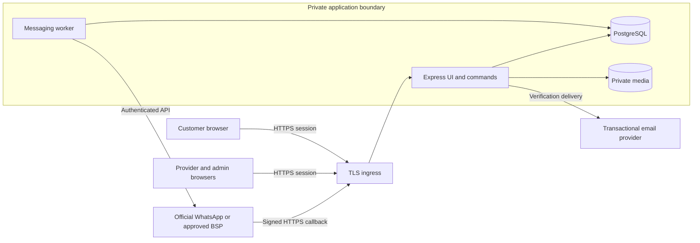
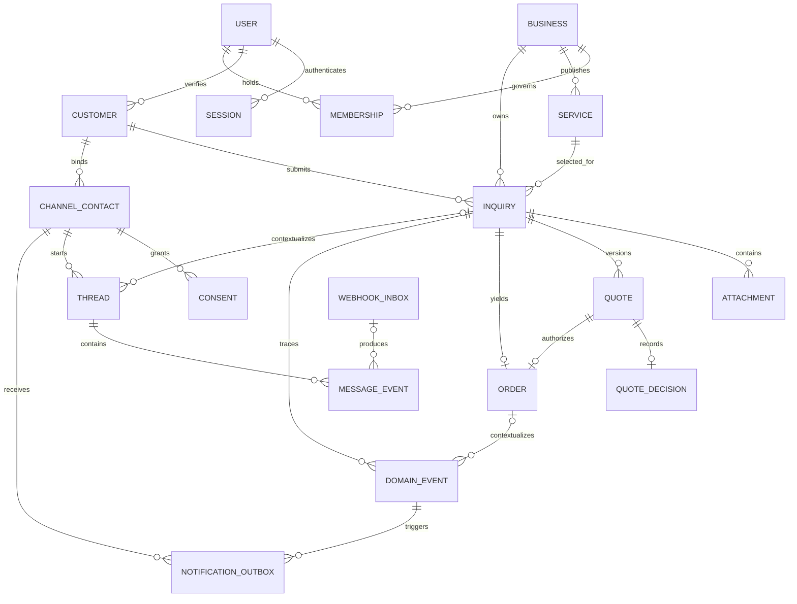
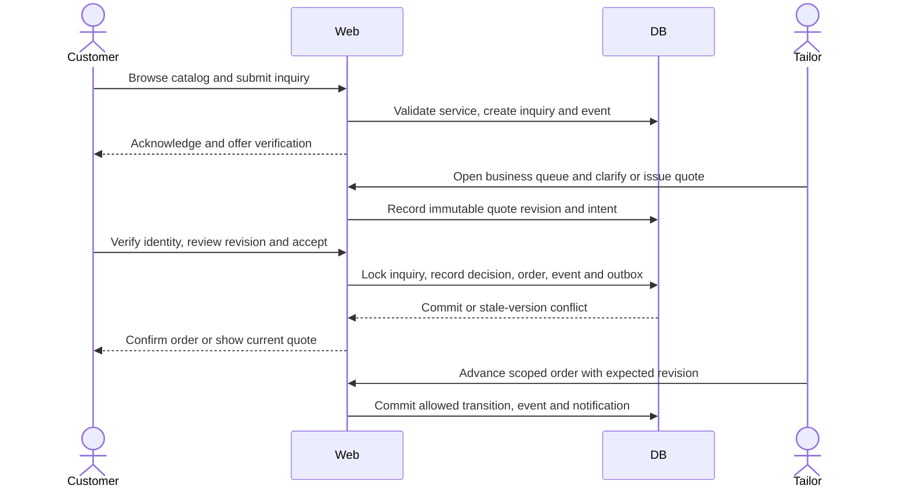
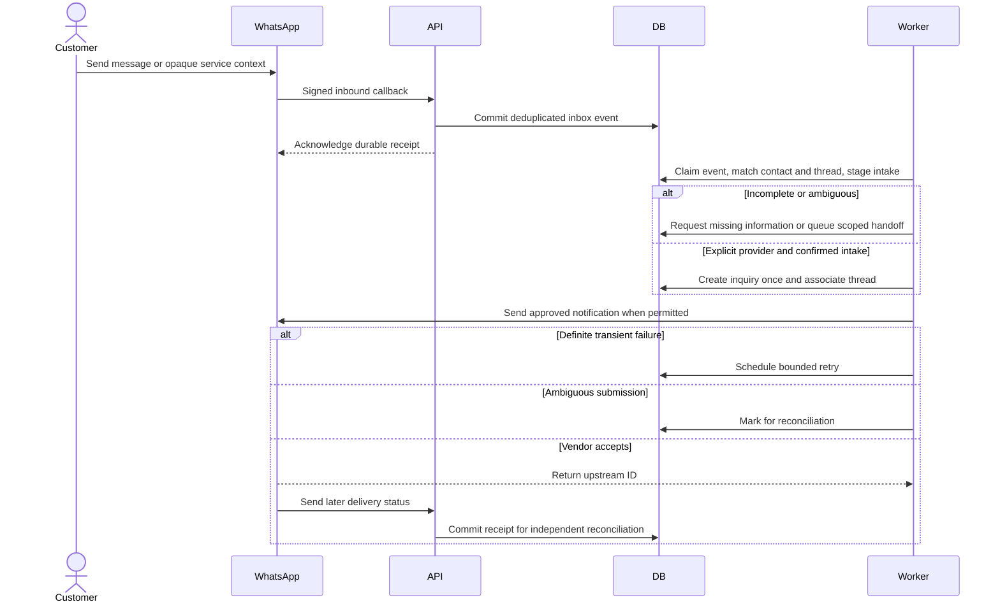
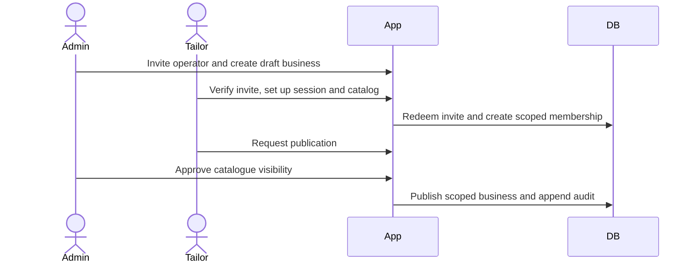

# RFC-0001 · Djahit reconstruction

**Status** Proposed for review · **Date** 18 November 2026 WIB · **Author** Codex, architecture draft · **Decision owners** Djahit product and engineering leads, with the team lead owning submission decisions. Individual owners are [OPEN].

[ADR register](../adr/README.md) · [Source-to-target migration](../migration/DJAHIT-SOURCE-TO-TARGET.md) · [Prioritized roadmap](../roadmap/DJAHIT-IMPLEMENTATION-ROADMAP.md)

## 1. Summary and review scope

[PROPOSAL] Build a same-origin, modular Express/PostgreSQL application with responsive server-rendered pages and a PostgreSQL-backed messaging worker. The customer chooses a tailoring service, submits an inquiry, receives a human-issued price and completion estimate, explicitly accepts one quote revision, and tracks an order. Tailors operate in a business-scoped dashboard. PostgreSQL owns the business state. A central Djahit WhatsApp number can capture inquiries and send updates through an official adapter.

[BLOCKER] Competition submission is on hold. The prior Djahit proposal documents its use for Poliwangi Beyond Business Season 3 (S3 PDF p. 14). SEVENT X restricts prior work (S1 p. 9) and TECHCOMFEST restricts previously published or previously entered work (S2 PDF p. 6). Each event needs its own written ruling on derivative use and any proposed cross-entry, including whether publishing for SEVENT X would affect TECHCOMFEST. Product design can proceed on a non-submission track. No organizer response, integration approval, team roster, or code implementation is established by this RFC.

## 2. Evidence and verified baseline

The user's request authorizes analysis and documentation. The context brief supplies product direction, historical claims and candidate design choices. This draft uses the brief's evidence labels:

| Label | Meaning |
| --- | --- |
| [FACT — SOURCE] | Observation in the identified archive, PDF or official page. A code observation is static unless a run is stated. |
| [PROPOSAL] | Suggested target behavior or decision awaiting review. |
| [UNVERIFIED] | Claim or environment whose operation or availability has yet to be demonstrated. |
| [OPEN] | Decision or question for a named role. |
| [BLOCKER] | Condition that prevents the affected release or submission step. |

[FACT — SOURCE] S4 is the immutable legacy baseline DJAHIT-LEGACY-V0-2026-11-18. The local ZIP hash is `f257aaae7c2920a700a2f06b3397e3f1dedf75ffe7351544dff63d91fc240f74`, with 175 files and 63,539,892 uncompressed bytes. Inspection used a temporary extraction. All 26 `.js` files passed `node --check`. No application, database, container or external integration was started. [UNVERIFIED] Remote GitHub state, clean deployment, end-to-end behavior, data volumes and external service health.

| Static finding [FACT — SOURCE] | Consequence |
| --- | --- |
| Express route registrations cover auth, account, repair requests, a tailor work queue and timeline (S4 `backend-branch/server.js:63–1527`). Tailor acceptance uses a row lock (1191–1256). | Reuse the concurrency principle. The legacy acceptance action is a tailor claim and carries no customer approval. |
| User enumeration has authentication without an admin gate (624–652). Tailor browse/detail selects unassigned customers' names, pickup contacts and image URLs (1046–1168). | Implement private tenant and ownership boundaries from the first slice. |
| Repair-update SQL emits numerical literals where bound placeholders are expected (907–953). Customer cancellation writes `Selesai` (987–1025). Tailor updates check a value list with no transition matrix (1369–1433). | Design explicit commands, use bound parameters and test concurrent transitions. A legacy completion label is ambiguous. |
| Google paths read or write columns absent from supplied SQL. The callback hands tokens to browser code via a fragment, browser auth uses local storage, and logout only signals client cleanup (328–453, 259–263, `config/passport.js`, `frontend/frontend/assets/js/loginv2.js`, SQL scripts). | Replace the session model and require clean-install contract tests. |
| The payment UI shows a success alert upon creating a repair request. The inquiry browser script references YOLO and several external upload, analysis and region endpoints (S4 `frontend/frontend/assets/js/formbayarv1.js:275–320`, `forminput2.js:97–315,396–563`). | Replace checkout with an explicit collection arrangement and bring media under app control. |
| SQL defines `users`, `repair_requests`, `order_timeline` and `blockchain_proofs`. The timeline trigger infers its actor, and the two Compose files differ. Root Compose points at paths absent at root, and backend Compose mounts initialization SQL without the tailor migration (S4 SQL, both Compose files, deploy script). | Use explicit domain events, ordered migrations and one supported build and deploy path. |
| Review of tracked source and package manifests found no official WhatsApp inbound/outbound adapter, quote versioning, provider catalog, reward ledger or settlement integration. S3 pp. 2, 4–7 and 18–25 document an earlier concept and mockups. | Treat these as product gaps or archived aspirations. The historical forecasts provide no pilot evidence. |

## 3. Problem, scope and measurable outcomes

[PROPOSAL] Validate whether tailoring MSMEs lose track of inquiries or spend time asking for missing details, and whether customers struggle to see price, ETA and progress. Use one city/service area and alterations or repairs. A provider can publish a profile and services after moderation, triage inquiries, request details, issue or revise quotes, and run the order queue. Customers can browse and submit as guests and must verify identity for private reads and quote decisions. Fulfillment is arranged manually and recorded in scoped notes. Admin work is limited to invitations, publication and controlled escalation.

P0 covers a complete web flow, private photos, business-scoped access, history, repeatable deployment and the messaging contract with a clearly labeled simulator or approved live delivery. P1 covers UX polish, queue summaries, search and pilot validation. Archived scope includes YOLO, blockchain, rewards, pricing AI, live payments/QRIS, logistics automation, offline sync and per-tailor WhatsApp accounts. ADR-0008 defines the collection and payment boundary.

[PROPOSAL] With 1–3 consenting tailors and consenting customer testers, compare matched manual and Djahit order-entry tasks. Record median time, sample size and task completion, missing required fields and clarification loops. In pilot workflows record inquiry-to-quote time and the fraction of quotes with a price and ETA. Targets for demo acceptance are a complete scripted journey on every run and a price/ETA on every sent quote. Pilot outcomes are directional and reported with limits. [UNVERIFIED] Participant availability and measured impact.

## 4. Architecture and trust boundaries

[PROPOSAL] Start a clean monorepo and reuse the stack and domain insights. Use Express, PostgreSQL and server-rendered templates with progressive enhancement. Default to one web process and a separate worker process from the same app image and revision. Managed PostgreSQL is preferred for hosted operation, with the host and private media service chosen after a deployment and restore check.

Trust the authenticated actor and resource scope resolved server-side. External callbacks enter a separate identity boundary. Browsers have no direct DB access. App and worker use restricted DB roles, and migrations use a separate deploy identity. Private media accesses go through a scoped application route. Simulator and real credentials use distinct environments.

| Option [PROPOSAL] | Trade-off |
| --- | --- |
| A. Clean Express/Postgres rebuild with server-rendered pages | Familiar code concepts and a single-origin deploy, with less client state and a smaller payload. Clear module boundaries and database-backed integration tests. Express requires explicit validation, authorization and transaction conventions. Team familiarity is inferred from S4 and needs confirmation. |
| B. New React SPA and framework API, or a framework-led TypeScript stack | Strong client component ergonomics for a richer dashboard. Learning, build, session and contract coordination add deadline risk without demonstrated performance or demo value for the first workflow. Consider only if the team can show a faster secure vertical slice. |
| C. Incremental refactor of the legacy release | Existing screens accelerate exploration. The repair marketplace model, browser auth, incompatible deployment files and private-data exposure raise rework and regression risk. A compatibility layer adds testing and hosting burden without a verified consumer. |

Within A, a web request can commit domain state while the worker performs independent retries. Inline messaging couples vendor availability to requests. A separate queue service improves isolation at higher load and adds operations for little initial value. Direct Meta Cloud API is the provisional first choice. An approved BSP is viable if onboarding and operations improve enough to justify its fees, contractual data handling and portability costs.

**Module ownership** · Identity owns accounts, verified contacts and sessions. Catalog owns businesses, membership, services and publication. Inquiry owns intake, attachments and clarification. Quotation owns revisions and decisions. Order owns accepted snapshots and lifecycle. Audit owns append-only event shapes and visibility. Messaging owns inbound adapter, threads and handoff. Notification owns consent checks, outbox and delivery evidence. Admin invokes audited moderation and operational commands. Modules call each other's application commands with actor context. The acceptance transaction spans quotation, order, timeline and outbox.

**Repo shape** · `apps/djahit` contains the web, templates/assets, domain modules and worker entry points. `db/migrations`, `infra`, `tests`, `docs` and one root `compose.yaml` complete the layout. One application package and lockfile fit a shared process image. Record source provenance in `LEGACY_ORIGIN.md` at skeleton creation. ADR-0002 defines the deployment choice.

## 5. Domain model and contracts

[PROPOSAL] Use opaque UUIDs, UTC `timestamptz`, configured WIB display, explicit currency `IDR` and validated integer rupiah with a bounded total. Completion estimates are local dates. Financial terms snapshot line items, total and terms on issuance and remain immutable after sending.

A guest `customer` can exist with nullable `user_id` and unverified contact. Verification attaches it to the authenticated principal by an explicit claim. A new WhatsApp sender receives a provisional customer/contact pair. Threads can be unassigned while intake is incomplete. Once complete, a thread segment attaches to a single inquiry and business. A contact can open further segments, selected explicitly using an opaque context reference. Unassigned threads are visible only in scoped platform triage. Contact or account merging requires verified proofs and review when ownership is ambiguous.

Key constraints and indexes:

- Active membership unique by business/user, with one enabled operator per MVP business. Customer, service, inquiry, quote and order references enforce ownership. Composite FKs pair `business_id` with scoped entity IDs, and the order's accepted quote must belong to its inquiry.
- Unique `(inquiry_id, version)`, at most one sent active revision with a partial index, unique decision per quote and unique order per inquiry and accepted quote. Quote line items and snapshot totals are validated together. Order and inquiry updates have monotonic revisions.
- Queue indexes on `(business_id, status, created_at, id)`, private history on `(customer_id, created_at, id)`, and event streams on `(inquiry_id, sequence)`. Provider sender identity unique per integration/number and opaque upstream sender ID. Message ID, inbox event key and outbox intent key are unique in their scopes. Jobs index state and next eligible time.
- Audit events carry inquiry/order, actual actor or service ID, event type, old/new state, reason code, timestamp and request correlation. Sensitive staff notes stay separate. Scope and filter customer timelines. Business deletion follows data lifecycle policy and preserves lawful, minimized audit through pseudonymization.

### Contract sketch

Most pages post same-origin forms to the same application commands. Use `/api/v1` JSON contracts when an interactive client needs them. No legacy public API compatibility is assumed. Representative contracts:

| Operation | Input and effect |
| --- | --- |
| `GET /api/v1/providers`, `GET /api/v1/providers/:slug` | Cursor-based public catalogue, slug, service area, published service and optional price hint. |
| `POST /api/v1/inquiries` | Published service ID, description, optional deadline and contact, idempotency key. Server assigns business and customer context. Returns 201 plus scoped reference. Guest receives a generic acknowledgement without private record access. |
| `POST /api/v1/inquiries/:id/attachments` | Authenticated owner or short-lived inquiry-scoped upload grant. Bounded image input, metadata response after validation. |
| `POST /api/v1/provider/inquiries/:id/actions`, `POST /api/v1/provider/inquiries/:id/quotes` | Scoped review/clarify/decline or issue revision, expected inquiry revision, and price/ETA/expiry. Replies and note visibility are explicit. |
| `POST /api/v1/quotes/:id/decisions` | Verified customer, exact quote revision, accept/reject, idempotency key. Returns decision and order on acceptance. |
| `POST /api/v1/provider/orders/:id/transitions` | Expected revision, named transition and allowed reason, scoped to business. `GET /api/v1/orders/:id/timeline` returns actor-appropriate events. |
| `GET/POST /webhooks/whatsapp` | Subscription challenge and authenticated event ingestion, isolated from browser session routes. |

Reject unknown commands and invalid shapes with 400/422, unauthenticated private actions with 401, disallowed operations within a visible scope with 403, private cross-scope reads with 404 and stale/reused conflicting commands with 409. Return stable error codes and safe field errors. For retries, persist command key, actor or guest scope, request digest and resulting resource in the business transaction. Same key and parameters replay safely, different parameters conflict. Recheck access on a replay.

### State and concurrency policy

| Aggregate | Valid transitions and actor |
| --- | --- |
| Inquiry | Submitted intake → `NEW`. Assigned provider moves to `NEEDS_DETAILS` or `UNDER_REVIEW`. Customer supplies requested details and returns it to `UNDER_REVIEW`. Sending a quote moves review → `QUOTED`. Customer accepts that revision → `ACCEPTED`; rejects → `UNDER_REVIEW` for re-quote. System expires the active quote and moves to `EXPIRED` with provider reopen to review. Provider may decline before acceptance with reason → `DECLINED`. Customer may cancel before acceptance → `CANCELLED`. Decline/cancel closes any sent quote as `WITHDRAWN`. |
| Quote | Provider drafts → `DRAFT`, then issues → `SENT`; replacing a sent revision marks the old one `SUPERSEDED` in the same transaction. Customer explicitly accepts/rejects the live revision. System expires it, or authorized inquiry closure withdraws it. All such outcomes are terminal for that revision. |
| Order | Acceptance atomically creates `CONFIRMED`. The provider's sent quote serves as offer/commitment. Provider moves `CONFIRMED → IN_PROGRESS → READY → COMPLETED` and can cancel a confirmed order with reason. Privileged exceptional cancellation of in-progress/ready work requires audited review and a reason. Completion/cancellation are terminal. |
| Delivery | `QUEUED → SENDING → SUBMITTED → SENT → DELIVERED` as evidence warrants. Retryable pre-send failure → `RETRY_WAIT`; policy denial → `SUPPRESSED`; permanent failure or exhausted retries → `FAILED`; ambiguous send → `NEEDS_REVIEW`. Provider receipt can skip interim states. Business state is independent. |

Lock the inquiry first for quote issue, expiry, withdrawal and decision. Recheck ownership, revision, current quote state and expiry using database time after acquiring the lock. For acceptance insert one decision, snapshot, order, audit event and eligible notification intent atomically. Concurrent acceptance, expiry and revision converge on a single valid outcome. An equivalent replay returns the existing result. A different decision or revision returns conflict. Order transitions use a row lock or a scoped compare-and-swap with expected revision. Illegal mutations write no event or intent. Use a worker or lazy expiry reconciliation with the same locked command. The migration plan covers preservation, staged imports and rollback.

## 6. Interaction sequences

All sequences are [PROPOSAL].

## 7. Messaging and delivery integrity

[PROPOSAL] The platform owns the business number, app credentials and support identity. The adapter exposes subscription verification, signed event normalization, allowed send and receipt normalization. Pin the selected provider API version at integration time. For Meta, verify the callback challenge and the raw-body signature using the app secret and constant-time comparison before parsing. Validate integration, account/number and schema, namespace signed events by configuration, persist each normalized envelope and acknowledge after commit. Invalid callbacks receive no business processing. Valid unsupported types can be safely ignored with a metric. Return a retryable response if durable ingestion fails. See [Meta webhooks documentation](https://developers.facebook.com/docs/graph-api/webhooks/getting-started/) and [WhatsApp Business Platform overview](https://developers.facebook.com/documentation/business-messaging/whatsapp/overview).

An opaque deep-link context indicates service and optional intake correlation. It contains no personal data and confers no permission. An authenticated customer may explicitly bind WhatsApp using an expiring, single-use challenge echoed by the inbound sender followed by confirmation in the original web session. An inbound-only customer completes an email verification/claim flow, with a separately delivered WhatsApp challenge if binding an existing account. For an active inbound thread the verification message uses the authorized channel; template gates apply outside the service window. Revocation or number change requires fresh proof. A phone match or link preview never grants access. MVP quote decisions and private tracking use verified web sessions.

Record opt-in evidence, purpose, contact, capture source, policy version and withdrawal. Check current purpose-specific consent, active binding, service window and template eligibility at send time. Initial notices are quote ready and order ready, with web tracking available regardless of delivery. Free-form replies use the current 24-hour customer-service window. Outside that window or for business-initiated outreach, use the applicable approved templates. Offer clear web support and a human triage path. Share only necessary intake fields with the selected provider and keep unsupported intake in the platform queue. Pricing varies by delivered message category and recipient market. Validate current rates, volume and BSP charges before choosing a spend cap. [WhatsApp Business Messaging Policy](https://whatsappbusiness.com/policy/) · [Platform pricing](https://whatsappbusiness.com/products/platform-pricing/)

Inbox receipts deduplicate by integration + event subtype + stable upstream ID or a normalized event fingerprint for types lacking IDs. A message-to-intake transition also has a domain uniqueness guard. Jobs use short claims with a lease, fencing token and next-attempt time. Use bounded exponential backoff with jitter and respect upstream retry advice. Authenticate again after configuration repairs as appropriate. A stale worker cannot commit another worker's result. The outbox key is business event + recipient + notification purpose, with durable attempt state before I/O. Ambiguous sends, including a worker crash after contacting a vendor with no proven idempotency support, go to reconciliation before manual retry. Accept that an external exactly-once guarantee depends on the vendor. Deduplicate receipts, reconcile receipts that arrive before response persistence, preserve evidence for contradictions and prevent old callbacks from regressing delivery. An operator can resolve or requeue with an audit trail. Alerts cover backlog age, failures and unknown outcomes. [OPEN] Approved number, access mode, templates, media-fetch support, provider replay documentation and actual end-to-end delivery.

## 8. Identity, privacy and threat model

[PROPOSAL] Password-based invited provider/admin accounts with adaptive hashing and email verification/recovery. Customers verify via expiring email challenges. Use revocable opaque server-side sessions stored as digests, secure HttpOnly SameSite cookies, rotation on login and privilege change, inactivity/absolute expiry and server logout. CSRF token and Origin checking on browser mutations, rate limits for sign-in/guest creation/challenge verification, scoped admin roles and reauthentication for sensitive account changes. Recovery tokens are one-time and invalidate existing sessions on reset. Serve private pages with cache and referrer protections. Link GET presents a confirmation screen while protected POST consumes the challenge. Strip secrets from access logs and URLs after handoff. Public demo uses synthetic contacts and a gated sandbox.

| Threat | Proposed control and proof |
| --- | --- |
| Cross-tenant access and guessable identifiers | Scope every list/read/mutation, event and photo lookup, including child IDs. Public fields are allowlisted. Tests cover two customers and two businesses. |
| Session theft, forged actions and account linking | Secure cookies, CSRF, rate limits, token hashing/expiry, replay tests, separate proof channels and audit. |
| Malicious file or URL | JPEG/PNG only initially, 5 MiB per image, capped pixel count and attachments, verify decoding and re-encode to strip metadata, store private with generated identifiers. Accept no arbitrary upstream URL for fetch. Vendor media IDs require allowlisted retrieval and the same checks. |
| Vendor spoof, duplicate submissions or timeout | Verify signed raw bytes and account, dedupe, isolate worker permissions, fail closed, test receipts and outage. |
| False completion or payment | Require allowed business transitions and explicit quote acceptance. Completion describes work. Only a separately audited cash receipt can represent actual collection if that scope is later approved. |
| Debug exposure, misuse of staff authority and data loss | Redact payloads, emails, phone numbers, photos and tokens from logs. Audit privileged actions, protect backups and restore to a private environment. |

[PROPOSAL] Minimize stored content to structured intake data and delivery metadata. Expire raw callback bodies after 7 days if temporarily required, abandoned intake and unclaimed uploads after 30 days, and closed-job media after 90 days. Retain minimized audit/dedupe metadata for up to 12 months subject to confirmed needs, with dedupe surviving the agreed vendor retry horizon. Prune terminal session/challenge artifacts after expiry and operational review period. Configure deletion jobs, unlink contacts, revoke sessions/access first, purge private objects and restore deletion tombstones before reopening restored data. [OPEN] Validate notices, controller/processor arrangements, region/access policy, consent/recovery process, retention and backup lifetimes before real pilot data.

## 9. Deployment, observability and verification

[PROPOSAL] Local root Compose launches database, app and worker with profiles for deterministic email/messaging fixtures. One migration runner applies versioned changes under a DB lock. CI uses a fresh PostgreSQL instance, migration/seed check, contract/unit/integration tests and browser tests. Hosted path uses HTTPS single origin, private DB and media, secrets supplied by the host and a safe staging environment. Run migrations as a predeploy operation and promote one tested image version. Add independent liveness, readiness that checks DB/schema, and worker heartbeat. Readiness should remain healthy through an upstream messaging outage. Track workflow errors, request latency, queue age, retry/dead-letter counts and receipt lag via redacted structured logs and metrics. Seed idempotently and provide an environment-guarded reset covering sandbox DB, queued jobs and private media. Store encrypted daily DB backups with matching media recovery and prove a restore. Provisional pilot objectives are RPO ≤24 h and RTO ≤4 h.

Proposed demo targets are 100% of ten scripted workflow runs, p95 ≤500 ms for representative core reads and writes under 10 concurrent synthetic users on staging, mobile catalog LCP ≤2.5 s under a documented throttled test, and durable callback acknowledgement p95 ≤1 s under fixture load. Keep uploads and vendor RTT outside synchronous request budgets and measure independently. Check mobile keyboard navigation, explicit labels/focus, contrast, loading, error and empty states. Tests cover fresh migration, auth and recovery, scoped reads/writes/media, transition matrix, quote races, replay, bad photo, webhook authenticity, retries, out-of-order callbacks and backups.

## 10. Delivery, risks and approval

[PROPOSAL] The [roadmap](../roadmap/DJAHIT-IMPLEMENTATION-ROADMAP.md) defines priorities, gates, owners and event-specific artifacts. Build the web path first. The earliest deadline is 30 November 2026. Treat live messaging and eligibility as parallel external dependencies. Record the demo from the deployed tagged release, show the real database-backed workflow, and label adapter results by environment. The [eligibility ADR](../adr/ADR-0009-competition-eligibility.md) tracks written rulings.

| Status | Decision needed and recommended default | Owner and impact |
| --- | --- | --- |
| [BLOCKER] | Written prior-work and cross-entry ruling per organizer. Retain submission hold. | Team lead · Registration, disclosure, public release and submission. |
| [OPEN] | Confirm team of exactly three eligible students from one institution if entering both. | Team lead · Shared roster eligibility. |
| [OPEN] | Confirm WABA/BSP, number, webhook domain, templates and test credentials. Use a central Djahit number, with live disabled until demonstrated. | Integration owner · Live scope and timeline. |
| [OPEN] | Confirm central intake plus provider dashboard, guest intake with verified web decisions, and narrow alterations/repairs. | Product lead · Tenant model, UX and catalog. |
| [OPEN] | Confirm manual fulfillment and cash on collection as arrangement only. Keep digital settlement out of MVP. | Product lead · Order states and claims. |
| [OPEN] | Confirm team stack readiness, host budget, secure mail and private media. Start with same-origin Express/Postgres and stage early. | Engineering lead · Deadline feasibility and recovery. |
| [OPEN] | Identify consenting pilot tailors and approve privacy/retention. Use synthetic data for public demos. | Product and privacy owners · Impact evidence and real-data go-live. |
| [OPEN] | Identify any authorized source database and rights to reuse historical assets. Default to fresh seed and historical archive. | Engineering and provenance owners · Import scope and publication. |
| [OPEN] | Clarify existing conflicts between TECHCOMFEST official sources. Use rulebook preliminaries as provisional. | Team lead · Demo emphasis and finalist logistics. |

Review and release checks:

- [ ] Approve P0 boundary, architecture and ADRs 0001–0008. Assign decision and workstream owners.
- [ ] Approve role, quote, tenant, retention and contract choices. Record provenance and finish the dependency/secret/license assessment before reuse or publication.
- [ ] Demonstrate seeded fresh start, deployment and restore. Run the negative and concurrency tests in the roadmap.
- [ ] Demonstrate the official integration with approved credentials or label simulation throughout. Document actual outgoing and incoming evidence and intentional fallback.
- [ ] Clear the independent event submission gates with accurate originality disclosures, working links, correct video and artifact formats, and verified team eligibility.

## Sources

- S1 · Local *SEVENT X – Software Development Rulebook.pdf*, pages cited as PDF pages. [SEVENT X official event page](https://sevent.zetech.id/)
- S2 · Local *Rulebook WEB APP Techcomfest 2027.pdf*, pages cited as PDF pages. [Official Web Application rulebook](https://techcomfest.ukmpcc.org/pdf/rulebook/Rulebook%20WEB%20APP%20Techcomfest%202027.pdf)
- S3 · Local *Salinan dari Politeknik Business Case.pdf*. Keep the source private because its appendices contain personal information.
- S4 · User-supplied `djahit3.0-main.zip`. Code locations are relative to the archive root.
- Context · `DJAHIT_CODEX_RFC_CONTEXT_2026-11-18.md`. The brief's S5–S7 working artifacts and S8 prior discussions were not independently used as source evidence.

