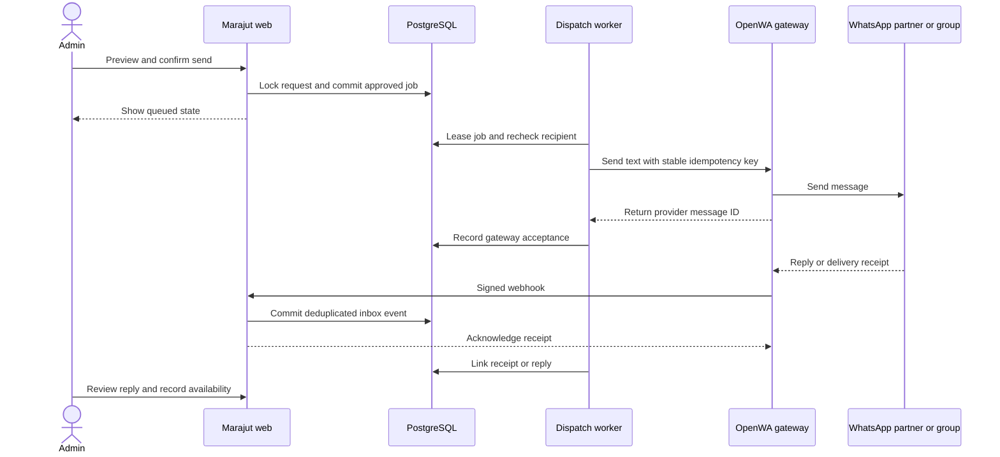

# RFC-0004 Marajut pilot reporting and OpenWA dispatch

**Status** Dispatch implemented and deployed for a restricted pilot. Reporting remains a draft. · **Date** 26 November 2026 WIB

## 1. Goal

Give admins a period-based view of how many tailoring requests arrive, how long the first quote takes, and how many requests become completed orders. Show verified website payments for the selected period so the team can distinguish live commission from test activity during pilot review.

Give admins a way to send a work announcement to the approved tailor group or contact the assigned tailor from **Koordinasi penjahit**. Tailors answer in WhatsApp. Admins use those replies to coordinate availability, the fixed quote, estimated completion, fittings, and handover. Customers continue to accept or decline quotes, track their orders, and pay on Marajut. Sections 2–4 specify reporting and sections 5–10 specify dispatch.

**Kinerja layanan** currently shows all-time request, order, and payment totals by service. This update uses the existing order timeline to make the quote response metric repeatable. Use the RFC-0002 sandbox for synthetic checks and the planned private HTTPS preview for invited pilot sessions. [Current performance view](../../apps/marajut/views/operations-performance.ejs) · [RFC-0002 pilot readiness](RFC-0002-MARAJUT-PILOT-READINESS.md)

## 2. Report definitions

Admins select **Seluruh periode**, **7 hari terakhir**, or **30 hari terakhir**. The seven-day and thirty-day ranges include today and end at midnight at the start of tomorrow in WIB. Use an inclusive start and exclusive end for timestamp comparisons. For example, the seven-day report on 26 November starts at 00.00 on 20 November and ends at 00.00 on 27 November, both in WIB.

| Metric | Definition |
| --- | --- |
| Requests received | Count each inquiry by the service it was submitted to and its creation time. A reassignment creates a separate request for the receiving service. |
| Accepted and completed | Of the requests received during the selected period, count those with an accepted order and those whose current order state is completed. Later progress on the same request contributes to its original period. |
| Time to first quote | For each request in the selected period, measure elapsed time from request creation to its first recorded quote issue. Round the median to whole minutes for display and show the number of requests with a recorded first quote. Show **Belum ada penawaran** when the sample is empty. |
| Verified website payments | Select paid payment rows by their verification time. Show live platform commission and partner share separately from demo and sandbox commission. Sum stored amounts and fees in whole rupiah. The all-time view also includes any verified payments without a recorded verification time. |

Label the request and payment portions of the report with their date basis. An order requested earlier and paid this week contributes to this week's payment figures. Its request and order progress appear with the period in which the request was created.

## 3. Reporting implementation order

1. **Add the report period to the admin route.** Read a single `period` query parameter on `/pengelola/kinerja`. Use `all`, `7d`, and `30d` as the supported values. Default missing or invalid values to `all`. Compute one pair of WIB boundaries for the report and pass them as parameters to the query. Use the route's existing admin authorization. [Admin routes](../../apps/marajut/operations-routes.js)
2. **Extend the existing performance query.** Use `inquiries.created_at` for the request group, the first `QUOTE_ISSUED` event for lead time, and `order_payments.checked_at` on `PAID` rows for the payment period. Select a single first-quote event per request. Aggregate the request and payment figures per service before combining them to avoid counting quote revisions or failed payment attempts. The management API and existing tailor workspace need the all-time results, with tailor results scoped to their business. [Performance query](../../apps/marajut/dispatch.js) · [Quote events](../../apps/marajut/quotes.js) · [Verified payment timestamps](../../apps/marajut/payments.js)
3. **Update the Kinerja page.** Put the three period controls above the report and show the selected range in WIB. Keep service and shop names together. Include the quote sample size and clear empty results. Use the existing scrollable table and check that keyboard navigation and the mobile page width work. The report presents service aggregates. [Performance view](../../apps/marajut/views/operations-performance.ejs)
4. **Rehearse with synthetic orders.** Create two services with requests across the boundary, revised quotes, and stored fixture payments tagged with each payment mode. Use demo checkout for the browser walkthrough. Capture the selected range and expected figures in the test run guidebook. Once the hosted pilot takes place, record the report period and sample size with the participant observations. [Sandbox setup](../../README.md#rehearse-in-a-fresh-demo) · [RFC-0004 test run](../TEST-RUN-GUIDEBOOK.md#rfc-0004-pilot-reporting-and-openwa-dispatch-plan--26-november-2026-wib)

## 4. Reporting acceptance checks

| Scenario | Pass condition |
| --- | --- |
| Period boundaries | Requests and payments at the WIB start count in the range. Records at the end boundary count in the next range. The selected period survives a reload, and an invalid value selects all time. |
| Quote time | Two requests with first quotes at 15 and 45 minutes show a 30-minute median and a sample of two. A later quote revision leaves the first-quote measurement intact. A request awaiting its first quote contributes to the received count. |
| Order and payment dates | An order accepted after its request period updates that request period's accepted count. A payment on an earlier request appears in its verification period. |
| Payment modes | A verified live payment of Rp80.000 with Rp4.000 in fees contributes Rp76.000 to partner share and Rp4.000 to live commission. Repeated checks preserve a single contribution. A verified test payment contributes only to test commission. |
| Role and layout | Only admins can open the period report and filter it with a keyboard on desktop and at 360 px. Customer access stays scoped to their orders. The existing tailor workspace reports only its own business. |

Run the Express/PostgreSQL suite and the customer, admin, and tailor browser paths against disposable QA. Record the fixture counts, displayed amounts, and browser checks in the guidebook. Repeat the key tasks with invited participants once the private preview is available. [Workflow tests](../../tests/workflow.test.js) · [Test run guidebook](../TEST-RUN-GUIDEBOOK.md)

## 5. Admin and tailor workflow

1. A customer submits a managed tailoring request and sees its price estimate. The admin opens the request and selects **Kirim ke grup** when seeking availability or **Hubungi mitra** to contact the currently assigned business. Both actions require an open request without a pending quote or an accepted order. The group action covers `OPEN`, `CONTACTED`, and `UNAVAILABLE` dispatch. The direct action covers `OPEN` and `AVAILABLE` dispatch.
2. Show the admin the destination label, a masked number for the direct action, and the exact text before **Konfirmasi kirim**. The group template uses the order reference, service, quantity, and a request to reply privately with that reference. The direct template adds the requested date when present and asks about availability, fixed price, estimated completion, and whether a fitting is needed. Both templates use text only. Customer contact details, addresses, photos, measurements, payment details, and free-text order notes stay in Marajut.
3. Show the send and receipt history on the same request. Label queued work **Dalam antrean**, gateway acceptance **Diterima gateway**, a verified direct receipt **Terkirim**, and uncertain outcomes **Perlu diperiksa**. Label mock activity **Simulasi WhatsApp**. When a reply is linked, show it with the sender and time to the admin.
4. The admin records **Penjahit bersedia** or **Penjahit berhalangan** from the reply. They align the scope, fitting date and place, estimated completion, and pickup or delivery using the existing quote and scheduling tools. A declined quote or unavailable partner can lead to a replacement request through the existing reassignment action. The customer reviews the fixed quote, approves the fitting when required, tracks progress, and pays through checkout after the order is ready. The admin checks payment before handover. [Dispatch panel](../../apps/marajut/views/managed-dispatch.ejs) · [Dispatch and reassignment rules](../../apps/marajut/dispatch.js) · [Quote rules](../../apps/marajut/quotes.js) · [Payment verification](../../apps/marajut/payments.js)

Keep the existing WhatsApp links and manual recording actions available when the queue is off or unavailable. The admin checks the chat before using a manual link for an uncertain send and records the result. The tailor receives the work and replies on WhatsApp using their existing number. Any existing tailor portal account stays scoped to its business.

After a verified private reply from the assigned tailor, **Penjahit bersedia** also authorizes a notice for the original group. Record availability and enqueue the notice in the same transaction when the original group announcement and current permission are known. The notice carries the order code and directs the selected tailor to continue privately with the admin. Keep one active or sent notice per original announcement and apply the existing send, cancellation, and review rules. [Group notice test run](../TEST-RUN-GUIDEBOOK.md#pemberitahuan-pesanan-sudah-diambil--28-november-2026-utc)

After the admin records availability, **Tindak lanjut WhatsApp mitra** offers a direct request for the tailor's quote. After customer approval, it offers messages for work, fitting, missed completion dates, payment and handover. Customers continue those actions on Marajut. Each follow-up uses the assigned partner's verified contact and requires its own admin confirmation. The worker rechecks the milestone and consent before sending, and the order retains one active or sent follow-up per purpose and milestone. Payment messages use the verified website state and label test payments as simulations. [Follow-up test run](../TEST-RUN-GUIDEBOOK.md#whatsapp-follow-ups-across-the-order--27-november-2026-utc)

The initial direct contact and quote follow-up use a numbered form for availability, the fixed total price, completion, fitting, and handover. A completed example beneath the form illustrates the expected values. The parser reads the answers above the example heading. The group announcement puts its order code on a separate line for copying. A signed direct reply with a valid offer fills the editor once the admin records availability. The admin can edit the imported total and terms before publishing through the website. [Quote form test run](../TEST-RUN-GUIDEBOOK.md#formulir-penawaran-whatsapp--28-november-2026-utc)

After the customer accepts, explicit replies from the verified assigned partner can update work, fitting, and handover through the existing order rules. An inability to proceed pauses fulfillment and alerts the admin. A proposed fitting time still requires the customer's approval, and shipping and completion require verified payment. The transaction saves the outcome with the inbox record. The customer's open order page polls an owner-scoped version every five seconds. [Automatic order update test run](../TEST-RUN-GUIDEBOOK.md#pembaruan-pesanan-otomatis-dari-whatsapp--28-november-2026-utc)

## 6. Components and boundaries

Marajut stays responsible for order state, approvals, quotes, fitting, payments, and reporting. The dispatch integration owns message approval, transport status, and an admin-only inbox for replies. Give its worker a small outbound adapter implemented by the mock and OpenWA. The adapter accepts the approved message snapshot and idempotency key, and returns a normalized result with a message ID, known refusal, safe retry, or uncertain outcome. Keep provider HTTP and webhook parsing at the integration boundary. Reuse the PostgreSQL lease and fencing approach from the existing outbox. Give dispatch its own queue and a separately stoppable worker process using the Marajut image. The current notification outbox addresses a recipient user and continues to handle customer notifications. [Notification schema](../../db/migrations/002_messaging.sql) · [Outbox worker](../../apps/marajut/outbox.js) · [Messaging reliability](../adr/ADR-0006-messaging-reliability.md)

| Setting | Purpose |
| --- | --- |
| `DISPATCH_WHATSAPP_MODE` | `disabled` by default. `mock` is for local and preview fixtures. `openwa` uses an approved private gateway. The existing `MESSAGING_MODE` still controls its own notification lane. |
| `OPENWA_BASE_URL` and `OPENWA_API_KEY` | Private gateway address and worker-only operator key. Scope the key to the approved session and specific group and partner chats. Separate gateway setup and QR access from the send key. |
| `OPENWA_SESSION_ID` and `OPENWA_GROUP_CHAT_ID` | One linked Marajut session and one approved group for the pilot. Resolve the direct destination from the assigned shop's approved current contact. |
| `OPENWA_WEBHOOK_SECRET` | Separate secret shared by the gateway subscription and Marajut web verifier. Load deployment secrets from protected configuration. |

Validate configuration before enabling a mode. Write mode and session into each job. A mock intent stays synthetic, and a job with a retired session or changed group goes to review or cancellation before any send. Normalize direct destinations to the documented `<number>@c.us` form and verify partner consent against that exact number. Configure the group as a fixed `@g.us` chat. Match WhatsApp aliases only through a verified mapping to that partner. [OpenWA authentication](https://docs.open-wa.org/guides/authentication) · [Sending messages](https://docs.open-wa.org/guides/sending-messages)

## 7. Approval and durable state

| Proposed record | Fields and constraints |
| --- | --- |
| `whatsapp_dispatches` | Dispatch UUID, inquiry and partner IDs, actor, channel, approved inquiry revision, request key, preview digest, mode, session, recipient and consent version, template version and rendered text. Store send state, attempts, lease token and expiry, next attempt, current attempt start, provider message ID, latest valid delivery evidence, and audit timestamps. Require uniqueness for the inquiry and request key, and for a provider message ID within its session and mode. Index due work and the request's message history. |
| `whatsapp_dispatch_inbox` | Mode, session, signed delivery idempotency key, event kind, provider message and chat IDs when available, normalized receipt or reply fields, received time, processing state, and correlation result. Require uniqueness on mode, session, and signed key. Index unmatched receipts and pending review. |
| `whatsapp_dispatch_permissions` | Partner and approved direct chat or the approved group chat, dispatch purpose, evidence reference, current permission version, who verified it, and grant or withdrawal time. Bind consent to the exact destination. Revocation, changed numbers, or changed group scope require fresh approval before queued work can go out. |

Put the direct opt-in grant and withdrawal controls on the existing **Kelola mitra** page, limited to admins. Record the proof reference and verified contact from that partner's current profile. The integration owner manages the pilot group as a closed group with verified opt-in for every member. They pause group approvals and recheck group permission when membership changes. Audit permission changes and show a clear reason when a dispatch action is unavailable. [Partner admin page](../../apps/marajut/views/partner.ejs)

Render both previews in the existing manager-only request page. Build the drafts on the server from current records. Use a digest of the server-rendered text, target, mode, permission version, and revision to detect a stale preview. The proposed `POST /api/v1/management/inquiries/:id/whatsapp-dispatches` accepts `channel` (`group` or `partner`), `revision`, `requestKey` (UUID), and `previewDigest`. Apply existing operator and manager authorization, CSRF protection, and management rate limits. [Management routes](../../apps/marajut/operations-routes.js) · [Browser CSRF middleware](../../apps/marajut/app.js)

In one transaction, lock the inquiry, check existing request-key use, and verify the current revision, dispatch eligibility, assigned business, destination permission, and preview digest. For a new approval, insert the immutable job, increment the inquiry revision, and write an `operator_events` audit entry referencing the dispatch. Return a redirect to **Koordinasi penjahit** or `202` and the dispatch ID for JSON. Return the existing result for a replay of the same approval and `409` for stale input or changed key reuse. Serialize approvals for the same inquiry. Allow one pending or previously sent announcement per request and channel. Check existing manual send records, show them alongside the queue, and block new sends while an earlier result is uncertain. Limit initiation to explicit admin actions.

Add a manager-only review action at `POST /api/v1/management/inquiries/:id/whatsapp-dispatches/:dispatchId/review` with the current inquiry revision, disposition (`sent` or `unsent`), and a reason. Lock and check both records, audit the decision, and use `CONFIRMED_MANUALLY` or `CANCELLED` respectively. Showing a send confirmed in WhatsApp is a separate status from a provider receipt. An unsent result can be replaced through a new preview and confirmation. Preserve history for both jobs, and flag late delivery evidence on the original for admin review.

## 8. Worker and gateway contracts

Run one dispatch worker replica for the pilot. Claim one due dispatch at a time with `FOR UPDATE SKIP LOCKED` and a fenced lease. Commit the claim before the preflight transaction, and take the inquiry lock before the dispatch row lock whenever a transaction needs both. Immediately before egress, recheck eligibility, assigned partner, rendered message fields, manual send records, and current permission and target. Use the approved snapshot as the send body. Cancel stale or withdrawn work. Record the current attempt start and release database locks before issuing HTTP. A send that already started can finish during reassignment or pause. Its history must stay attached to the original inquiry, with operator review before a replacement send to that destination.

Use OpenWA `0.32.1` as the contract baseline with the Baileys engine. Check that the session is `ready`. Send `POST /api/sessions/{sessionId}/messages/send-text` with `X-API-Key`, `Idempotency-Key` equal to the dispatch UUID, and JSON `{chatId, text}`. Persist the nonempty `messageId` from a valid `201` response as `SENT` using the current lease token. Track delivery separately. Limit text to the documented 4,096 characters. The gateway retains a send key for 24 hours, so retries reuse the same key and body within a shorter window. [OpenWA send contract](https://docs.open-wa.org/guides/sending-messages) · [Session troubleshooting](https://docs.open-wa.org/reference/troubleshooting)

| Outcome | Worker action |
| --- | --- |
| Queued job or due retry | Lease as `SENDING`, then check the request and target. An expired lease before attempt start can be reclaimed with a new fence. |
| Session offline before send, or documented safe pacing refusal | Set `RETRY_WAIT`. Start with delays of 30 seconds and 2 minutes and allow up to three attempts over 15 minutes from approval. Honour `Retry-After` within that window. When confirmed pre-send failures exhaust the budget, mark `FAILED`. |
| Confirmed rejection before send | Mark `FAILED` with a short reason such as invalid target or revoked key. Allow a new approval once the admin resolves the issue. |
| Request timeout, uncertain gateway response, missing message ID, or lease expiry after attempt start | Set `NEEDS_REVIEW`. Treat `IDEMPOTENCY_OUTCOME_UNKNOWN`, `IDEMPOTENCY_KEY_IN_PROGRESS`, and unclassified responses this way. The admin inspects WhatsApp before confirming the result or using the manual fallback. |
| Ineligible request, revoked consent, or changed recipient before send | Mark `CANCELLED` with a reason and require a new preview if the request becomes eligible again. |

Use an initial HTTP deadline of 15 seconds and a 60-second lease, then validate both against the pinned gateway in QA. A late worker write must fail the lease check. Keep request and worker logs on internal job IDs, reason codes, and timings. Restrict message content and full destination identifiers to the queue records and admin review.

## 9. Receipts and partner replies

Mount `POST /webhooks/openwa` before browser JSON parsing and CSRF. Accept bounded raw `application/json`, with a 64 KiB payload ceiling at Marajut and `WEBHOOK_MAX_PAYLOAD_BYTES=65536` at the gateway. Set `WEBHOOK_MEDIA_INLINE_MAX_BYTES=0` and disable media handling in the app. Verify `X-OpenWA-Signature` as `sha256=<hex>` using HMAC-SHA256 over the exact body bytes and a constant-time digest comparison. Parse and validate the signed body's `event`, `sessionId`, `idempotencyKey`, `timestamp`, and event data. Use the signed session and key for deduplication. Apply the 30-day replay window to the signed envelope timestamp, and check the original message timestamp before linking a reply to a dispatch. Accept only the configured session and permitted chats. [OpenWA webhook envelope and verification](https://docs.open-wa.org/guides/webhooks) · [Webhook configuration](https://docs.open-wa.org/getting-started/configuration)

Configure one subscription for `message.ack` and `message.failed` with a chat filter. Configure a second for `message.received` with approved chat, text, and `fromMe: false` filters. Verify the scope again in Marajut. Insert only normalized fields and return `204` after commit or for an authenticated duplicate or ignored event. Return `401` for bad signatures, `400` for malformed supported payloads, and `503` if the event could not be recorded. Keep signed raw bodies in memory for the verification step.

- **Receipts.** Match normalized provider message ID and original chat within the same mode and session. Store an early receipt for reconciliation when the outbound `messageId` is written. For direct chats, advance from gateway accepted to delivered to read. Preserve the strongest verified evidence through duplicate or late events. A correlated failure with no delivery evidence prompts review. Receipts with incomplete or ambiguous IDs stay unmatched for review. Group sends show gateway acceptance during the pilot.
- **Replies.** Accept bounded text from an opted-in partner on an approved chat, using the sender identity carried by the signed payload, including the participant identity for a group. Ignore own-message echoes. Match an explicit order reference to a single eligible dispatch for that sender. A partner may reply privately to a group announcement if their chat and membership in that group are verified. Apply the same membership check to a reply in the group itself. Route known-sender replies with absent or ambiguous references to an admin inbox. Drop unapproved sender content. Treat messages as plain text and escape it in the admin view. Use verified quoted message IDs for matching only after testing that field on the selected engine.
- **Business actions.** Apply the inbox event and mark it processed in one transaction. Deduplicate repeated reply effects by mode, session, chat, and provider message ID as well as by webhook delivery key. The admin uses existing actions to record the reply, negotiate the quote, or select another partner. Customer business timelines and service performance totals use the existing order and payment records.

## 10. Rollout and acceptance

1. **Mock workflow.** Add the migration, approval endpoint, dedicated worker, and admin preview and history. Implement the mock adapter and use disposable synthetic QA with distinct receipts and replies. Land the reporting work from sections 2–4 independently of the gateway.
2. **Private gateway.** Add an opt-in Compose overlay with the pinned OpenWA image and Baileys engine. Resolve the version tag to a digest before enabling it on the pilot host. Mount a protected volume at `/app/data` for gateway storage and linked session state. Put the gateway, web service, and dispatch worker on a private dispatch network. Give the gateway outbound access to WhatsApp and keep PostgreSQL on its existing network. On the gateway allow only the Marajut callback hostname in `SSRF_ALLOWED_HOSTS`, with the guard enabled. Route the callback directly over the private network and exclude it from the browser proxy. Restrict QR pairing and gateway configuration to the integration owner through private access. Record the upstream version and dependency license for the release. [OpenWA installation](https://docs.open-wa.org/getting-started/installation) · [Gateway configuration](https://docs.open-wa.org/getting-started/configuration) · [Competition release checks](../adr/ADR-0009-competition-eligibility.md)
3. **Observe and recover.** Show worker age, gateway readiness, oldest queue item, and review counts in **Operasional**. Provide steps to stop the dispatch worker, disable new approvals, review in-flight work, and continue with manual links. Keep callback verification available for outstanding receipts while paused. Revalidate permissions and session before resuming. Back up any required gateway state separately under restricted access. Protect session files and keys as credentials. In a restore, disable outbound sends and reconcile existing dispatches before restoring worker access. Retain reply text and rendered drafts for a proposed seven days after dispatch or triage completes. Retain minimized audit and dedupe metadata across the provider replay window, with a proposed 30-day minimum for dedupe and a 12-month maximum for minimized audit, subject to privacy approval. Include gateway stores, pending review, and backups in the retention review. [Authentication and retention](../adr/ADR-0007-authentication-and-retention.md)
4. **Approved pilot.** OpenWA uses a linked WhatsApp session through an unofficial gateway. Require usage authorization under WhatsApp's terms, a dedicated Marajut-managed number, and recorded recipient opt-in before any real send. The integration owner records which group and partner chats are authorized, pairs the number, and captures results for one group and one direct dispatch with a partner reply. Use simulated mode in public or competition demos. ADR-0004 proposes the official API or an approved provider for production. [OpenWA project](https://www.open-wa.org/) · [WhatsApp Terms of Service](https://www.whatsapp.com/legal/terms-of-service) · [Business Messaging Policy](https://whatsappbusiness.com/policy/) · [Production messaging proposal](../adr/ADR-0004-whatsapp-integration.md)

| Scenario | Pass condition |
| --- | --- |
| Admin approval | Confirm one group and one direct preview. Each uses its approved destination and excludes customer data. A repeat click or concurrent submission creates a single job per channel. A stale revision, changed preview, missing opt-in, changed assignment, or revoked consent prevents a send. |
| Worker recovery | Exercise safe pre-send failures, a gateway timeout after HTTP starts, worker restart on either side of attempt start, and a stale worker response. Proven pre-send retries keep the same key and body. An uncertain outcome stays in review. Manual confirmation or a new approved send preserves the previous audit record. |
| Callback and reply | Send invalid signatures, valid repeats, mismatched chat/session data, early or out-of-order receipts, an eligible reply, and a reply without an unambiguous reference. Reject invalid traffic. Deduplicate valid effects and retain the strongest receipt. Link only the matching reply and expose unknown context for admin review. |
| Role and fallback | A customer and a signed-in tailor cannot read or approve dispatch messages or open the inbox. Manual clicks and recording actions still work when disabled. Switching from mock to OpenWA leaves mock jobs local. Reassignment keeps both requests' histories separate. |
| Shared workflow | Repeat customer estimate, quote accept/decline, fitting, payment, and history. Repeat existing tailor sign-in and business-scoped views. For a managed request confirm the partner can reply in WhatsApp and the admin can record the reply, issue the quote, and complete the order. |
| Authorized gateway test | Verify the pinned version, chat-scoped key, private callback, session restart, group announcement, direct receipt, and inbound reply with the approved setup. Compare the Marajut timeline and WhatsApp chat for the same reference before enabling wider pilot access. |

Run `npm run build`, `npm test`, and the existing browser smoke paths on fresh QA data once implemented. Run the synthetic dispatch and signed webhook fixtures there before exercising the authorized gateway. Record reproducible results and any pending checks in the guidebook. [RFC-0004 test run](../TEST-RUN-GUIDEBOOK.md#rfc-0004-pilot-reporting-and-openwa-dispatch-plan--26-november-2026-wib) · [Sandbox setup](../../README.md#rehearse-in-a-fresh-demo)
