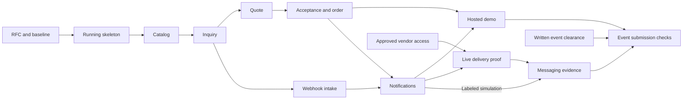

# Marajut implementation roadmap

## Product transition · 19 November 2026 WIB

| Work | Status | User outcome |
| --- | --- | --- |
| Marketplace identity and discovery | Implemented on the existing Express application | The Marajut homepage connects service search, public shops, an explanation of ordering, an optional local chat simulation and a dedicated entry for tailors. |
| Customer and tailor navigation | Implemented on schema 005 | A guest can sign in and resume the simulator. A customer can return to chat or review orders. The tailor can open the scoped chat queue beside incoming requests, active work and pickup. |
| Indonesian product copy and design system | Implemented for the shared shell and entry workflows | The wordmark, thread mark, plum and linen palette, photography, responsive headers, simulator screens and account email use the new identity. Newly seeded services have Indonesian names. Existing shop content is retained. |
| Service-specific web-to-chat handoff | Recommended next slice, subject to the reconcept brief | From a published service, let a customer enter the simulator with that service in context, confirm the destination, and return to the linked inquiry for a versioned quote. Cover unpublished services and conversations already assigned to another shop. |
| Official WhatsApp and pilot | Open | Real sender enrollment, consent, approved transport, receipts, and field sessions with tailoring businesses still require separate work. |

The owner’s transition request establishes the scope above. Alignment with the full Phase 1 brief is pending receipt of the referenced file. The earlier RFC, ADRs, and dated delivery entries below retain the reconstruction history. [Product gap assessment](../product/MARAJUT-PHASE-1.md) · [Verification guide](../TEST-RUN-GUIDEBOOK.md#t11--marajut-discovery-and-workspace)

**Status** [PROPOSAL] · 18 November 2026 WIB · [RFC-0001](../rfc/RFC-0001-MARAJUT-RECONSTRUCTION.md) · [Migration plan](../migration/SOURCE-TO-TARGET.md)

## Delivery priorities and dependencies

### Product experience reset

The [Chrome audit and gap assessment](../product/MARAJUT-UX-GAP-ASSESSMENT.md) prioritizes day-to-day provider work. The first slice introduced actionable queues, editable business identity, customer-visible profiles, and linked request/conversation context. The next slice adds category and keyword discovery, provider-managed intake guidance and estimates, structured web requests, itemized quote revisions, and private photos. The existing simulation path can issue and accept itemized quotes. Email verification and recovery, retention rules for pilot data, and a restore rehearsal remain before a private pilot. Live delivery, public release, and competition eligibility retain independent gates.

### First implementation pass

Local implementation is authorized. The RFC and ADRs still contain decisions for later review, and ADR-0009 continues to block competition publication and submission.

| Slice | Implementation status |
| --- | --- |
| S0 | Legacy archive fingerprint rechecked. New application and synthetic data lineage recorded in `LEGACY_ORIGIN.md`. |
| S1 | Local Node image and PostgreSQL Compose stack, migrations, fixture seed, sessions, readiness and worker heartbeat implemented. CI, shared staging, sandbox reset command and restore rehearsal remain pending. |
| S2 | Two seeded businesses, customer discovery and business-scoped service creation/editing/hiding implemented. Provider invitation, profile moderation and publication workflow remain pending. |
| S3 | Authenticated web inquiries support garment quantity, fit notes, and private photos. The assigned provider can see them in the work queue. Guest verification, account recovery, and photo retention policy remain pending. |
| S4–S5 | Versioned itemized quotes, rejection and acceptance, one accepted order, fulfillment transitions and timeline implemented. Accepted orders retain their accepted version and breakdown, and older total-only quotes remain readable. Background expiration and privileged cancellation remain pending. |
| S6 | Simulated signed webhook, durable normalized inbox, retry and deduplication, two-step sender binding, scoped triage, simulated replies and draft conversion or linking are implemented locally. Real sender verification and provider callbacks remain pending. |
| S7 | Quote-ready and order-ready notifications, simulator, repeat-safe receipts, scoped inbox, opt-in preference and bounded retries implemented locally. Official delivery, receipts, templates and policy integration remain pending. |
| S8–S9 | Local Compose reached readiness on the existing database. Eleven automated PostgreSQL/HTTP checks passed. Both Chrome smoke runs passed, covering the regular order workflow and simulated intake through proof, handoff, conversion and quote acceptance. Hosted deployment, performance evidence and a consenting pilot remain pending. |

The first slice implements outbound simulation independently of S6. Only the live WhatsApp path depends on verified inbound identity, template and policy work. Authenticated seed accounts replace guest verification for the local slice, and sending the first quote can combine reviewing and quoting in a single command. When a quote expires, the local slice rejects acceptance and lets the provider reissue directly. These choices keep the full web workflow demonstrable while deferring the broader RFC state and identity behavior.

### Local pilot workflows · 19 November 2026

Migration 005 implements verified guest drafts, signup and password recovery, scoped tailor invitations and shop moderation, audited exception review and manual cash records. The worker handles email and expires quotes even with messaging disabled. The simulator transfers structured intake to the inquiry and supports unlink with retained customer history. Local tooling includes a fresh sandbox command, encrypted backup and restore, retention preview and a repository CI workflow. The current run evidence is in the [test run guidebook](../TEST-RUN-GUIDEBOOK.md).

Open gates are shared staging and external smoke checks, provider approval and end-to-end verification for live email and WhatsApp, the retention schedule and backup destination for real pilot data, observed pilot sessions with consenting tailors, and written competition clearance for submission. The live WhatsApp adapter and external delivery reconciliation depend on the selected account and provider contracts.

[FACT — SOURCE] Legacy code exists and its JavaScript syntax was checked. [UNVERIFIED] Legacy runtime or deployment success. The tables below define the planned release gates. Local implementation evidence is recorded above. Hosted and live-integration gates remain open.

| Priority and slice | Dependencies | Work and exit evidence | Suggested owner |
| --- | --- | --- | --- |
| P0 · S0 Design and baselines | User review | Accept RFC/ADRs, designate leads, freeze archive, review reuse rights/dependencies/secrets. Open event rulings and confirm whether product work proceeds separately. | Product, engineering and team leads |
| P0 · S1 Running skeleton | S0 approval | Root Compose, app image, DB migrations, redacted logs, fixture email, seed/reset, test CI, staging TLS, DB readiness and worker heartbeat. Prove repeatable boot from empty checkout/DB. Wire server-side sessions early. | Engineering and release |
| P0 · S2 Provider catalog | S1 | Invite operator, add scoped membership, create profile and services, moderate/publish, browse on mobile. Two-tenant tests verify unpublished and foreign data stay private. | Product/UI and engineering |
| P0 · S3 Inquiry | S2 | Customer selects a service, sends inquiry as guest or verified customer, adds validated private photos and receives verification path. Provider sees scoped persisted inquiry. Test link replay, invalid upload, duplicate submissions and access separation. | Product/UI and engineering |
| P0 · S4 Quote | S3 | Provider clarifies or issues a priced, expiring revision with ETA. Customer can verify and review exact terms. Test visibility, revision replacement and expired quotes. | Engineering |
| P0 · S5 Acceptance and order | S4 | Atomic accept and create order, provider progress to ready/completed, customer timeline, cancellation/rejection rules. Prove one order under races and persisted events through restart. | Engineering and QA |
| P0 · S6 WhatsApp intake | S3; activation requires approved access | Ship normalized inbox and fixture-signed webhook, deterministic intake selection and explicit handoff. Prove duplicate deliveries make one inquiry, malformed/foreign callbacks cause no business writes, and ambiguous intake stays unassigned. | Integration and QA |
| P0 · S7 Notifications | S5 and S6 | Transactional intents, consent/template checks, worker leases, retries, receipt and unknown-delivery review. Prove vendor downtime leaves accepted orders usable. For live enablement, observe an approved inbound round trip and approved outbound delivery receipt. | Integration and engineering |
| P0 · S8 Production demo | S5 for core, S7 for messaging claims | Verify deploy/restore from a release tag, synthetic reset, E2E and defensive test suite, accessibility and performance budget. Record mode and exact observed steps. Smoke-test externally with judge-equivalent access. | Release and QA |
| P1 · S9 Refinement and evidence | S5, privacy approval for real data | Observed pilot tasks with consent, improve mobile and failure UX, queue summaries, discovery search, profile polish. Recheck performance and capture observed results with sample/limits. | Product/UI and QA |
| P2 · Deferred | New ADR and owner | Per-provider WhatsApp accounts, automated logistics, settlement, ML, blockchain, rewards and offline mode. | Product |

The schedule critical path is S0–S5 then the hosted journey. Stage the first deployed slice early. S6/S7 can overlap web lifecycle work once S3 contracts settle. Live vendor access and event rulings have independent schedules. Prioritize privacy, accepted quote and timeline if time tightens. Trim catalog breadth, analytics and polish first. A web-only build can validate core product value if messaging falls behind. Describe its exact scope and seek event confirmation on any planned simulated segment.

## Milestones and go/no-go

Dates use WIB. Dates are planning targets; team capacity, deployment venue and integration access are [UNVERIFIED]. Role names may be shared across the team.

| Window | Work | Exit decision |
| --- | --- | --- |
| 18–22 Nov | Review RFC, provenance and organizer questions. After authorization, prioritize S1 and stage a clean app. Check actual capacity and vendor access. | G1 baseline hash passed, dependency/security assessment pending until completed. G2 architecture approved before implementation. If no bootable staging slice by 22 Nov, narrow the November feature commitment. |
| 23–26 Nov | S2–S5, with S6 adapter and fixtures in parallel where capacity permits. | G3 usable quote-to-order workflow and negative tests by 26 Nov. Without G3, defer competition release. |
| 27–30 Nov | S7/S8, recording and conditional release. Test approved official messaging if ready. Freeze and smoke-test the artifact before the deadline. | G4 real or clearly labeled simulated evidence, with standalone workflow available. G0 written clearance and G5 event artifacts required for any authorized SEVENT X submission. |
| 1–18 Dec | Stabilize S8, S9 and pilot evidence. Prepare TECHCOMFEST cut with provision and publication checks. | G0 and G5 for TECHCOMFEST by 18 Dec 23:59. If the project was published for another event, verify that earlier publication is included in the ruling. |
| 5–10 Dec and Jan 2027 | If selected, SEVENT X technical meeting on 5 Dec and online final on 10 Dec. TECHCOMFEST finalist announcement 6 Jan, in-person final 27 Jan at Politeknik Negeri Semarang. | Follow confirmed registration/confirmation and final-round instructions. |

**G0** governs competition decisions and release. Resolve written eligibility or record a decision to proceed with non-entry product work. **G1** requires archive integrity and dependency/security review. **G2** requires approval of RFC, ADRs, schema and contracts. **G3** requires verified business workflow and isolation. **G4** distinguishes official delivery evidence from simulation. **G5** requires correct competition-specific release and artifacts.

## Verification matrix

| Gate | Evidence to retain |
| --- | --- |
| G1/G2 | Archive fingerprint and evidence inventory, rights and dependency/credential follow-ups, schema/contract review and recorded ADR approval. |
| G3 | Fresh migrate and synthetic seed, browser journey for customer and provider, scoped tenant/ownership/privacy matrix including attachments, provider revocation, verified guest claims and account recovery, invalid transitions, rollback and race outcomes. |
| G4 | Signature/replay fixtures, duplicate intake proof, outbox retry and restart, message receipt ordering, opt-out suppression, timeout/unknown review, provider outage with order continuity. Separately retain live test account/mode and redacted upstream IDs, timestamps and receipts for any official integration claim. |
| G5 | Tagged staged release and clean hosting, tested encrypted restore, accessibility/performance checks, external link access, demo mode disclosures, provenance, eligibility and team/artifact confirmation. |

## Conditional competition packages

[BLOCKER] Both event release rows are conditional. No proposal, registration, publication or organizer contact was sent as part of this analysis.

| Requirement | SEVENT X Software Development / Website | TECHCOMFEST Web Application / Subtheme 2 |
| --- | --- | --- |
| Deadline | 30 Nov 2026 (S1 pp. 7, 16). Confirm portal cutoff time. | 18 Dec 2026, 23:59 WIB (S2 PDF p. 9). Registration ends 17 Dec. Allow time for verification (S2 PDF pp. 8–9). |
| Team | 3–5 eligible students from same institution (S1 p. 6). | Maximum 3, same institution, one TECHCOMFEST category per person (S2 PDF p. 5). Live category page displays 2–3. Shared roster needs exactly three. |
| Hosted and source | Active publicly accessible website and public active GitHub repo during competition (S1 pp. 10–11). | Public hosted app and judge-accessible GitHub source. Monorepo if frontend/backend are separate (S2 PDF pp. 7, 9). |
| Supporting artifacts | Required organizer proposal template with unchanged structure, max 25 pages excluding cover/references/appendices, and truthful organizer originality form. YouTube demo ≤5 min, named `Nama Tim \| SoftDev - SEVENT X National Competition` (S1 pp. 10–11). | Accessible Google Drive demo video and web/source links via portal. Registration evidence and verification per S2 PDF p. 9. Builder and application template restrictions apply, AI-assisted work must be understood and explainable (S2 PDF pp. 6–7). |
| Preliminary rubric | Functionality/code 30%, theme 25%, originality 20%, urgency 15%, UX/accessibility 10% (S1 p. 14). | PDF rubric functionality/performance 30%, theme/solution 25%, UX/aesthetics 25%, demo video 20% (S2 PDF pp. 7–8). Official category page instead lists functionality/features 40%, UI/UX 25%, creativity/innovation 20%, theme 15%. |
| Finals | Online 10 Dec. Presentation/material 40%, conduct/communication 25%, demo/simulation 15%, Q&A 20% (S1 pp. 15–16). | Top ten and in-person 27 Jan 2027 (S2 PDF p. 9). PDF gives a 2–9 Jan confirmation window alongside a 6 Jan announcement, while the official home page shows 9–16 Jan finalist registration. Confirm whether these are distinct tasks and obtain the final-round rules. |

[SEVENT X official site](https://sevent.zetech.id/) · [TECHCOMFEST rulebook](https://techcomfest.ukmpcc.org/pdf/rulebook/Rulebook%20WEB%20APP%20Techcomfest%202027.pdf) · [TECHCOMFEST category page](https://techcomfest.ukmpcc.org/competition/web-application) · [TECHCOMFEST official site](https://techcomfest.ukmpcc.org/)

[PROPOSAL] Record one canonical hosted walkthrough from seed. Show service discovery, inquiry, tailor quote/ETA, verified acceptance, provider progress, customer timeline and the messaging mode with visible labeling. Capture real vendor delivery only when verified. Use event-specific edits and show one measured SDG 8 workflow outcome if pilot evidence is available. Rehearse a synthetic demo reset and supply a recovery route for live walkthrough failures.

